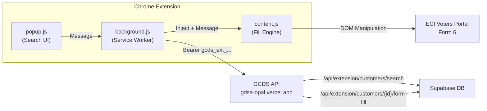

# 🚀 GAZI SMART FORM FILLER — Chrome Extension

**Production-ready Manifest V3 Chrome Extension** that integrates with the GCDS (Gazi Customer Data Store) backend to securely auto-fill ECI Voters Portal Form 6.

---

## 📁 File Structure

```
extension/
├── manifest.json        # Manifest V3 configuration
├── background.js        # Service worker: API client, auth, message routing
├── popup.html           # Search + Confirm + Settings UI
├── popup.css            # Premium dark theme with glassmorphism
├── popup.js             # Popup controller (search, confirm, settings)
├── content.js           # ECI Form 6 smart fill engine
└── icons/
    ├── icon16.png       # Toolbar icon
    ├── icon48.png       # Extension page icon
    └── icon128.png      # Chrome Web Store icon
```

## 🏗️ Architecture



## 🔐 Security Features

| Feature | Implementation |
|---------|---------------|
| **Auth** | SHA-256 hashed pairing tokens (`gcds_ext_...`), Bearer auth |
| **Inactivity Timeout** | 30-minute multi-operator kiosk protection (`chrome.alarms` + session/local purge) |
| **Diagnostics** | Privacy-safe DOM report generator (auto-scrubs Aadhaar, phone, EPIC, names) |
| **CORS** | Origin-whitelisted (`chrome-extension://...`), no wildcard `*` |
| **PII Protection** | Mobile masked in search, Aadhaar/PAN/GST never returned |
| **No Silent Submit** | Submit button is NEVER automated — human review mandatory |
| **Fail-Safe** | Detects missing DOM selectors, notifies user instead of misfilling |
| **Token Storage** | `chrome.storage.local` (encrypted at rest by Chrome) |
| **Tenant Isolation** | All queries scoped to `business_id`, cross-tenant = 404 |

## 🔌 GCDS API Integration

The extension uses **two existing API endpoints** with pairing token auth:

### 1. Customer Search
```
GET /api/extension/customers/search?q={query}
Authorization: Bearer gcds_ext_<64-hex-chars>
```
Returns: `[{ id, customerCode, name, mobileMasked }]` (max 15, privacy-hardened)

### 2. Form Fill DTO
```
GET /api/extension/customers/{id}/form-fill
Authorization: Bearer gcds_ext_<64-hex-chars>
```
Returns the complete form-fill DTO with:
- `name` (first, middle, last, fullName, originalLanguageName)
- `dateOfBirth`, `gender`, `mobile`, `email`
- `relative` (father, mother, spouse — with first/middle and surname)
- `address` (street, city, PO, pincode, district, state)
- `epic` (voter ID number)
- `electoral` (AC name, AC number, part number, serial number, verification status)

## ⚙️ Setup Instructions

### 1. Load the Extension

1. Open Chrome → `chrome://extensions/`
2. Enable **Developer mode** (top-right toggle)
3. Click **"Load unpacked"**
4. Select the `extension/` folder from this project

### 2. Configure GCDS Connection

1. Click the extension icon in the toolbar
2. Click the ⚙️ **Settings** icon
3. Enter:
   - **API URL**: `https://gdsa-opal.vercel.app`
   - **Pairing Token**: Your `gcds_ext_...` token
4. Click **"Test Connection"** to verify
5. Click **"Save Settings"**

### 3. Get a Pairing Token

1. Log in to GCDS dashboard
2. Go to **Settings → Extension Tokens**
3. Click **"Generate New Token"**
4. Copy the token (shown only once!) and paste into the extension

### 4. Register Extension ID

After loading the extension, Chrome assigns it an ID (e.g., `abcdefghijklmnop...`). Add this to your `.env.local`:

```env
ALLOWED_EXTENSION_IDS=<your-extension-id>
```

> [!IMPORTANT]
> Without this, the CORS layer on the API will reject requests from the extension.

## 🎯 How to Use

1. Navigate to **voters.eci.gov.in** and open Form 6
2. Click the **GAZI SMART FORM FILLER** extension icon
3. **Search** for a customer by name, code, or phone
4. **Review** the customer identity confirmation card
5. Click **"Fill ECI Form 6"**
6. The extension fills fields with **visual highlights** (purple → green)
7. **Review all fields manually** before submitting on the ECI portal

## 🧠 Smart Fill Engine Details

### Async Dropdown Cascade (State → District → AC)

The ECI portal uses **dependent dropdowns** that load asynchronously:

```
State selected → District options load (async) → District selected → AC options load (async)
```

The fill engine uses a **dual approach**:
1. **MutationObserver** — watches for option additions in real-time
2. **Polling fallback** — checks every 300ms (up to 12 seconds) for slow government servers

### React/Angular Compatibility

ECI's portal uses a frontend framework. The fill engine:
- Uses `Object.getOwnPropertyDescriptor(HTMLInputElement.prototype, 'value').set` for React
- Dispatches `input`, `change`, `blur`, `keydown`, `keyup` events
- Handles both `formcontrolname` (Angular) and `name`/`id` (generic) selectors

### Ambiguity Handling

If a field mapping is uncertain, the extension **leaves it blank** rather than risk misfilling. Skipped fields are reported in the status message.

## 🔧 Troubleshooting

| Issue | Solution |
|-------|----------|
| "Not connected" | Check API URL and token in Settings. Click "Test Connection". |
| "Token expired" | Generate a new token from GCDS dashboard (tokens last 30 days). |
| "Cannot inject into this page" | Navigate to `voters.eci.gov.in` first, then click Fill. |
| "DOM may have changed" | The ECI portal updated its HTML. Report for selector updates. |
| Fields not recognized by ECI | Each filled field dispatches `input`+`change` events. If ECI still doesn't recognize, try clicking into/out of the field. |

---

> [!CAUTION]
> This extension NEVER automates the final Submit button. Always review all filled fields before submitting on the ECI Voters Portal. Accuracy is the responsibility of the human operator.
